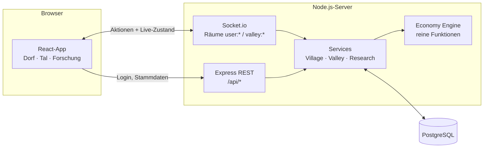
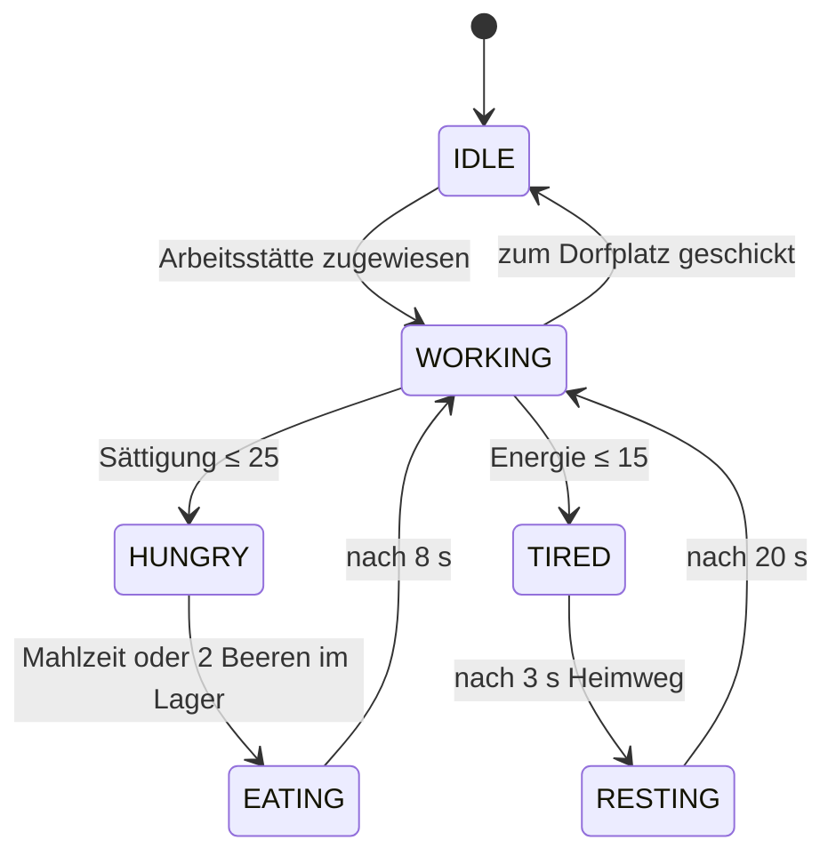
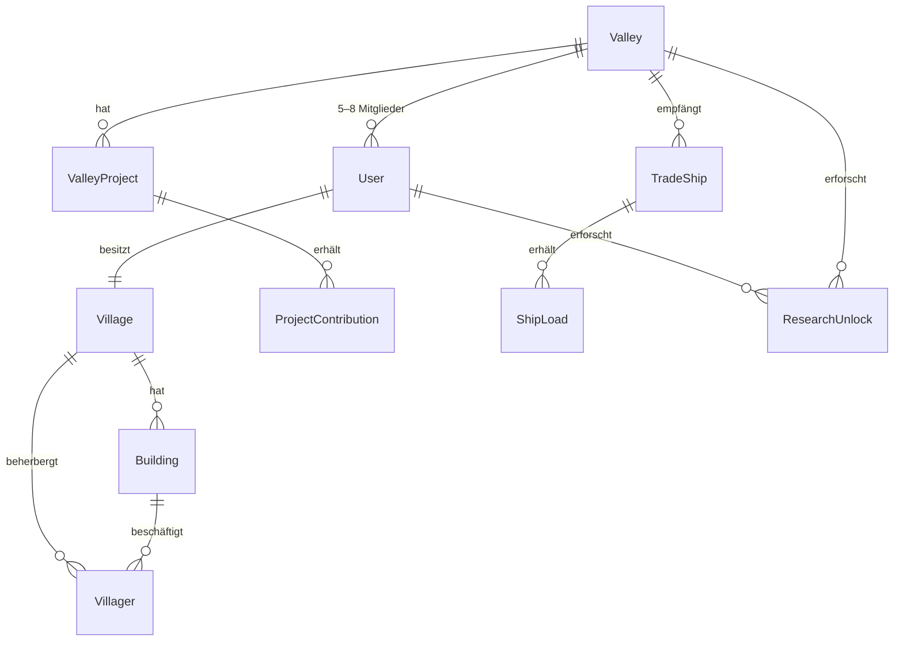

# 🍃 Mosswood

**Ein kooperatives, friedliches Tal-Aufbauspiel im Browser.**
Fünf bis acht Spieler teilen sich ein Tal. Jeder bewirtschaftet seinen eigenen Hof, und gemeinsam baut ihr Monumente, beladet das Handelsschiff und erforscht neue Techniken. Es gibt kein PvP und keine Angriffe: *Cozy Gaming* und *Slow Gaming*.

 
---

## Inhalt

- [Features](#features)
- [Tech-Stack](#tech-stack)
- [Architektur](#architektur)
- [Projektstruktur](#projektstruktur)
- [Schnellstart](#schnellstart)
- [Konfiguration](#konfiguration)
- [Spielmechanik im Detail](#spielmechanik-im-detail)
- [Echtzeit-API (Socket.io)](#echtzeit-api-socketio)
- [REST-API](#rest-api)
- [Datenmodell](#datenmodell)
- [Branches & Workflow](#branches--workflow)
- [Roadmap](#roadmap)

---

## Features

| Bereich | Umfang im Prototyp |
| --- | --- |
| 🏡 **Heimatdorf** | 10 Arbeitsstätten (6 Rohstoff-, 3 Veredelungs- und eine Versorgungsstätte), Lager mit Kapazitätsgrenze, Gebäude-Vorrat zum Einsammeln |
| 🧑‍🌾 **Dorfbewohner** | 2 zu Beginn, bis zu 5 über Forschung. Zuweisung per Drag-and-Drop oder Antippen, Zustands-Loop *Arbeiten → Hungern/Ermüden → Essen/Ausruhen → Weiterarbeiten* |
| ⚙️ **Economy Engine** | Produktions-Timer, Rezepte (Holz → Planken, Lehm → Ziegel, Fasern → Stoff, Beeren + Weizen → Mahlzeiten), Offline-Fortschritt bis 8 h |
| 🏞️ **Tal** | Gemeinsame Monumente (Moosbrücke, Große Bibliothek, Laternenfest) mit Echtzeit-Fortschritt, Ereignis-Feed, Online-Status der Nachbarn |
| ⛵ **Handelsschiff** | Kommt in festen Abständen, verlangt drei Warenkisten vom ganzen Tal und belohnt alle Helfenden mit Siegeln und Prestige |
| 📜 **Forschung** | Hof-Techniken (Tempo, Lager, Schubkarren, neue Hütten) und Tal-Techniken, von denen alle Nachbarn profitieren |
| 📱 **UI** | Mobile-first, Tailwind CSS v4, eigene warme Mosswood-Farbpalette |

## Tech-Stack

- **Frontend:** React 19, TypeScript, Vite 6, Tailwind CSS 4, socket.io-client
- **Backend:** Node.js ≥ 22, Express 5, Socket.io 4, Zod (Validierung)
- **Datenbank:** PostgreSQL 16 mit Prisma ORM 6
- **Deployment:** Dockerfiles für Server und Client (nginx) und `docker-compose.yml`
- **CI:** GitHub Actions (Schema-Check, Engine-Tests, Client-Build)

## Architektur



**Grundprinzipien**

1. **Der Server ist die einzige Wahrheit.** Der Client schickt nur *Absichten* (z. B. „Ida in die Holzfällerhütte“). Der Server prüft, simuliert und sendet den neuen Zustand zurück.
2. **Lazy Simulation.** Jedes Dorf speichert `lastTickAt`. Bei jedem Zugriff rechnet die Engine die vergangene Zeit nach, so entsteht auch Offline-Fortschritt. Für verbundene Spieler läuft zusätzlich ein Tick alle `TICK_MS` Millisekunden.
3. **Reine Engine.** `server/src/game/engine.js` kennt keine Datenbank und ist deshalb mit `node --test` direkt testbar.
4. **Konsistenz.** Pro Dorf läuft immer nur eine Änderung gleichzeitig (In-Process-Lock). Einzahlungen ins Tal laufen in `Serializable`-Transaktionen mit automatischem Retry, sodass gleichzeitige Spenden mehrerer Spieler nicht verloren gehen.
5. **Eine Quelle für Inhalte.** Gebäude, Rezepte und Forschung stehen in `server/src/game/content.js`. Der Client lädt sie über `GET /api/content`.

## Projektstruktur

```
mosswood-coop-webapp/
├── client/                     # React-Frontend (Vite)
│   ├── src/
│   │   ├── components/
│   │   │   ├── village/        # HomeVillage, VillagerCard, BuildingCard, InventoryBar
│   │   │   ├── valley/         # ValleyView, ProjectCard, TradeShipCard, DepositControl
│   │   │   ├── research/       # ResearchPanel
│   │   │   ├── Login.tsx, Shell.tsx, ui.tsx
│   │   ├── game/GameProvider.tsx   # Socket-Verbindung, Zustand, Aktionen
│   │   ├── lib/                # API-Client und Typen
│   │   └── index.css           # Tailwind-Theme (Mosswood-Palette)
│   ├── Dockerfile, nginx.conf
├── server/                     # Node.js-Backend
│   ├── prisma/
│   │   ├── schema.prisma       # User, Valley, Village, Villager, Building, ValleyProject, ...
│   │   ├── migrations/         # SQL-Migrationen
│   │   └── seed.js             # Demo-Tal mit Nachbarn
│   ├── src/
│   │   ├── server.js           # Express + Socket.io Einstiegspunkt
│   │   ├── realtime/socket.js  # Räume, Events, Simulations-Loop
│   │   ├── routes/api.js       # REST-Endpunkte
│   │   ├── services/           # village-, valley-, research-, authService
│   │   ├── game/               # content.js, engine.js, effects.js
│   │   └── utils/
│   ├── test/engine.test.js
│   └── Dockerfile
├── docker-compose.yml
└── .github/workflows/ci.yml
```

## Schnellstart

### Variante A: Alles per Docker

```bash
docker compose up --build
```

Danach läuft das Spiel auf **http://localhost:8080** (API auf Port 4000, Postgres auf 5432). Die Migrationen werden beim Server-Start automatisch angewendet.

### Variante B: Lokale Entwicklung

Voraussetzungen: Node.js ≥ 22 und ein PostgreSQL 16 (lokal installiert oder nur die Datenbank per Docker: `docker compose up -d db`).

```bash
npm install                               # installiert server + client (npm workspaces)
cp server/.env.example server/.env        # unter Windows: copy server\.env.example server\.env
npm run db:deploy                         # Migrationen anwenden
npm run db:seed                           # optional: Demo-Tal mit Einladungscode
npm run dev                               # Server :4000 und Client :5173 parallel
```

Öffne **http://localhost:5173**, gib einen Namen ein (optional den Einladungscode aus dem Seed) und zieh ins Tal. Für Koop-Tests einfach ein zweites Browserfenster im privaten Modus öffnen.

### Nützliche Skripte

| Befehl | Zweck |
| --- | --- |
| `npm run dev` | Server (mit `--watch`) und Vite-Client gleichzeitig |
| `npm test` | Engine-Tests (Zustands-Loop, Produktionsketten, Forschung) |
| `npm run build` | Client typprüfen und bauen |
| `npm run db:migrate` | Neue Migration aus Schema-Änderungen erzeugen (`prisma migrate dev`) |
| `npm run db:seed` | Demo-Tal anlegen |
| `npm run db:studio -w server` | Prisma Studio zum Durchsehen der Daten |

## Online stellen (GitHub Pages + Render + Neon)

GitHub Pages liefert nur statische Dateien aus. Deshalb ist das Spiel aufgeteilt:

| Teil | Hosting | Adresse |
| --- | --- | --- |
| Client (React) | GitHub Pages, automatisch bei jedem Push auf `main` | https://n0ahwag.github.io/mosswood-coop-webapp/ |
| Server (Express + Socket.io) | Render, Blueprint in [`render.yaml`](render.yaml) | z. B. `https://mosswood-server.onrender.com` |
| Datenbank (PostgreSQL) | Neon (kostenloser Tarif) | Verbindungs-URL aus dem Neon-Dashboard |

**Einmalige Einrichtung**

1. **Neon:** Projekt anlegen und die *direkte* Verbindungs-URL kopieren (ohne `-pooler` im Hostnamen, mit `?sslmode=require`).
2. **Render:** *New → Blueprint* wählen, dieses Repository verbinden und bei `DATABASE_URL` die Neon-URL eintragen. Die Migrationen laufen beim Start automatisch.
3. **GitHub:** Unter *Settings → Secrets and variables → Actions → Variables* die Variable `API_URL` mit der Render-Adresse anlegen (ohne Schrägstrich am Ende).
4. Den Workflow *GitHub Pages* unter *Actions* einmal neu starten oder etwas auf `main` pushen.

Gut zu wissen: Der kostenlose Render-Server schläft nach 15 Minuten ohne Besucher ein. Der erste Aufruf danach dauert etwa eine Minute. Weitere erlaubte Herkünfte lassen sich in `CORS_ORIGIN` kommagetrennt ergänzen.

## Konfiguration

Alle Variablen stehen in `server/.env.example`:

| Variable | Standard | Bedeutung |
| --- | --- | --- |
| `DATABASE_URL` | – | PostgreSQL-Verbindung |
| `PORT` | `4000` | HTTP-/WebSocket-Port |
| `CORS_ORIGIN` | `http://localhost:5173` | Erlaubte Herkünfte des Clients (kommagetrennt) |
| `TICK_MS` | `2000` | Simulations- und Sync-Intervall für verbundene Spieler |
| `MAX_OFFLINE_SECONDS` | `28800` | Maximal nachgerechneter Offline-Fortschritt (8 h) |
| `SHIP_INTERVAL_MINUTES` | `240` | Pause zwischen zwei Schiffsbesuchen |
| `SHIP_DOCK_MINUTES` | `120` | Liegezeit im Hafen |

## Spielmechanik im Detail

### Dorfbewohner-Zustände



Ohne Essen im Lager bleibt ein hungriger Bewohner stehen. Die Küche ist deshalb das Herz jedes Hofs.

### Produktion

- Ein Gebäude arbeitet nur, wenn mindestens ein Bewohner im Zustand `WORKING` zugewiesen ist. Ein zweiter Arbeiter bringt +80 % Tempo.
- Veredelungsgebäude verbrauchen ihre Zutaten **zu Beginn** eines Zyklus aus dem Dorflager.
- Fertige Waren landen im **Gebäude-Vorrat** (`stockCap`). Ist er voll, stoppt das Gebäude, bis jemand *Einsammeln* drückt oder die Forschung „Schubkarren“ das automatisch erledigt.
- Das Dorflager hat eine Kapazität pro Rohstoff (Basis 100, erweiterbar).

Werte wie Dauer, Rezepte und Kapazitäten lassen sich zentral in `server/src/game/content.js` anpassen.

### Tal & Handelsschiff

- **Monumente** haben Anforderungen pro Rohstoff. Jede Einzahlung wird protokolliert (`ProjectContribution`) und sofort an alle Talbewohner gesendet. Ist ein Monument fertig, erhalten **alle** Mitglieder Prestige und Siegel.
- **Das Handelsschiff** verlangt drei Kisten, deren Menge mit der Zahl der Talbewohner wächst. Wer mindestens eine Ware lädt, bekommt beim Füllen der letzten Kiste die Belohnung. Fährt es unvollständig ab, kommt nach `SHIP_INTERVAL_MINUTES` das nächste.

## Echtzeit-API (Socket.io)

Verbindung mit `io({ auth: { token } })`. Alle Aktionen antworten per Ack-Callback mit `{ ok: true, data }` oder `{ ok: false, error }`.

| Richtung | Event | Payload |
| --- | --- | --- |
| C → S | `villager:assign` | `{ villagerId, buildingId \| null }` |
| C → S | `building:collect` | `{ buildingId }` |
| C → S | `project:contribute` | `{ projectId, resource, amount }` |
| C → S | `ship:load` | `{ resource, amount }` |
| C → S | `research:unlock` | `{ techKey }` |
| S → C | `village:state` | vollständiger Dorf-Zustand (nur an den Besitzer) |
| S → C | `valley:state` | Mitglieder, Projekte, Schiff, Tal-Forschung |
| S → C | `valley:event` | `{ id, icon, text, at }` für den Ereignis-Feed |

## REST-API

| Methode | Pfad | Beschreibung |
| --- | --- | --- |
| `GET` | `/api/health` | Lebenszeichen |
| `GET` | `/api/content` | Rohstoffe, Gebäude, Forschung, Projekte |
| `POST` | `/api/auth/guest` | `{ displayName, inviteCode? }` → `{ token, user }` |
| `GET` | `/api/me` | Profil (Header `Authorization: Bearer <token>`) |

> **Hinweis:** Der Gast-Login ist ein Platzhalter für den Prototyp. Das Token wird nur als SHA-256-Hash gespeichert. Für den Live-Betrieb sollte ein echtes Account-System (z. B. E-Mail-Magic-Link oder OAuth) folgen.

## Datenmodell



Details stehen in [`server/prisma/schema.prisma`](server/prisma/schema.prisma).

## Branches & Workflow

- `main`: stabiler Stand (Production)
- `dev`: Integrations-Branch für neue Features

Neue Features entstehen in eigenen Branches (`feature/...`) und gehen per Pull Request nach `dev`. Releases werden von `dev` nach `main` gemergt. Die CI prüft jeden Push und jeden Pull Request.

## Roadmap

- [ ] Echte Accounts (Magic Link / OAuth) statt Gast-Login
- [ ] Gebäude-Level und Ausbaukosten
- [ ] Isometrische Dorfkarte (Canvas/PixiJS) zusätzlich zur Kartenansicht
- [ ] Tal-Weltkarte mit freischaltbaren Gebieten
- [ ] Chat und Hilfe-Anfragen zwischen Nachbarn
- [ ] Tal-Wechsel, Einladungsverwaltung, Rollen
- [ ] Horizontale Skalierung: Redis-Adapter für Socket.io und verteilte Locks
- [ ] In-Memory-Cache für aktive Dörfer statt Schreiben bei jedem Tick
- [ ] Upgrade auf Prisma 7, sobald die Treiber-Adapter-Migration erledigt ist

---

*Mosswood ist ein eigenständiges Projekt mit eigener Welt, eigenen Namen und eigenem Look.*
